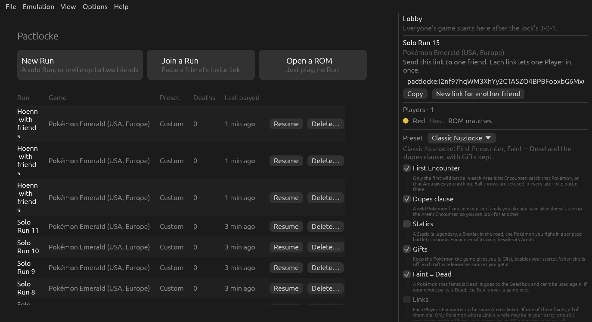

# Pactlocke

**Play GBA Pokémon Nuzlocke and Soul Link challenges, alone or with up to two friends, with the rules enforced for you.**

Pactlocke is a desktop app with a GBA emulator built in. You bring your own ROM, pick the challenge rules, and play. The app watches the game and applies the rules itself: a ball is refused in an Area you've already used, a fainted Pokémon goes to the Dead box, and in a Soul Link your partner's Pokémon dies when yours does. Nobody keeps a spreadsheet and nobody has to be trusted.

> **Status:** working title, pre-release. Windows, Linux and macOS are built and tested in CI.

> **No piracy.** Pactlocke does not include, download, host or link to any game, ROM, BIOS or Romhack, and we do not condone piracy. Use it only with games you own, dumped from your own cartridges. See [ROMs and piracy](#roms-and-piracy).

## Contents

- [What you get](#what-you-get)
- [Get Pactlocke](#get-pactlocke)
- [Play solo](#play-solo)
- [Play with friends](#play-with-friends)
- [Controls](#controls)
- [Supported games](#supported-games)
- [ROMs and piracy](#roms-and-piracy)
- [The rules](#the-rules)
- [Playing with friends, in depth](#playing-with-friends-in-depth)
- [The app, in depth](#the-app-in-depth)
- [How it works](#how-it-works)
- [About this repository](#about-this-repository)
- [Licence and credits](#licence-and-credits)

## What you get

- **Rules that enforce themselves.** First Encounter, Dupes clause, Faint = Dead, level caps, no items, set mode, must nickname, type clause, Gifts and Statics. Every rule is optional.
- **Co-op for up to three Players.** Each plays their own copy of the same game. Links tie your Encounters together, Sync Gates hold boss battles until everyone is ready, and you can watch each other's games live.
- **No accounts and no server.** You send a friend an invite link. The apps talk to each other directly.
- **Nothing to lose.** Close the app, crash, or lose power, and Resume puts you back where you stopped, on the same frame as your friends.
- **Your ROM stays yours.** Pactlocke reads it into memory and never copies, changes or sends it.

## Get Pactlocke

### Download a release

Download the latest version for your system from the [Releases page](https://github.com/vknt-m/pactlocke/releases), unzip it anywhere, and run `pactlocke`. There is nothing to install: the app keeps its data in a `data` folder beside itself. Each download includes the licences of everything built into it.

Everyone in a Run with friends needs the same version.

### Or build it from source

You need:

- [Rust](https://rustup.rs) through rustup. It installs the version this repo pins by itself.
- CMake 3.13 or newer.
- A C compiler: Visual Studio 2022 Build Tools with the C++ workload on Windows, gcc or clang on Linux, the Xcode command line tools on macOS.
- On Linux, the ALSA, X11 and Wayland development packages (the list is in [`.github/workflows/ci.yml`](.github/workflows/ci.yml)).

Then:

```bash
git clone --recurse-submodules https://github.com/vknt-m/pactlocke.git
cd pactlocke
cargo run --release -p pactlocke-app
```

If you cloned without `--recurse-submodules`, run `git submodule update --init` first.

### What else you need

A ROM of a [supported game](#supported-games), dumped from a cartridge you own. Pactlocke ships no games and links to none.

## Play solo

1. Start Pactlocke. The first time, it asks for your name.
2. Choose **New Run** and pick your ROM.
3. Pick a preset (**Classic Nuzlocke**, **Soul Link** or **Hardcore**), or tick the rules you want. Each rule has a description under it.
4. Start the Run and play. **View › Side panel** shows the feed, your party, the Areas you've used, the Graveyard and the Ruleset.
5. To stop, use **File › Suspend and quit**. **Resume** on the home screen brings you back to the same spot.

**Open a ROM** on the home screen just plays a game with no Run and no rules.

## Play with friends

Everyone needs Pactlocke (the same version) and their own copy of the same ROM.

**The Host:**

1. Choose **New Run**, pick the ROM, then **Invite friends…**.
2. The Lobby opens with an invite link. Send it to one friend; each link lets one Player in. **New link for another friend** makes a second.
3. Pick a preset or set the rules. Everyone sees the Ruleset change live.
4. When every Player has ticked **Ready**, choose **Lock and start**.

**Each friend:**

1. Choose **Join a Run** and paste the invite link.
2. Pick your copy of the ROM when asked.
3. Tick **Ready**.



*The Host's Lobby: the invite link, who has joined, and the rules being picked.*

After the lock there's a 3-2-1 countdown and every game starts from a new game at the same moment. From then on:

- The **Player strip** at the top of the side panel shows where each Player is and what they're doing, with a **Watch** button to see their game.
- If you close the app or lose your connection, the others play on. Choose **Resume** on the home screen to come back.

More in [Playing with friends, in depth](#playing-with-friends-in-depth).

## Controls

| GBA | Keyboard |
|---|---|
| A / B | X / Z |
| L / R | A / S |
| Start / Select | Enter / Backspace |
| D-pad | Arrow keys |
| Fast-forward (hold) | Tab |
| Pause | P |
| Mute | M |
| Side panel | Ctrl+B |
| Fullscreen | F11 |
| Screenshot | F12 |

A gamepad works too. **Options › Settings › Controls** rebinds the GBA buttons, fast-forward and pause.

## Supported games

A game is supported through a Game Profile for one exact ROM, matched by its SHA-1.

| Game | Version |
|---|---|
| Pokémon FireRed | USA 1.0 |
| Pokémon LeafGreen | USA 1.0 |
| Pokémon Ruby | USA 1.0 |
| Pokémon Sapphire | USA 1.0 |
| Pokémon Emerald | USA, Europe |
| Radical Red (Romhack) | 4.1 |
| Unbound (Romhack) | 2.1.1.1 |
| Gaia (Romhack) | 3.2 |
| Glazed (Romhack) | 9.2.0 |
| Heart and Soul (Romhack) | 2.0.6 |
| R.O.W.E. (Romhack) | 2.1.9.1 |

- **Romhacks:** bring the already-patched ROM. Pactlocke hosts and links to no Romhack.
- **Other Romhacks:** one laid out like a supported game runs as **Untested**. Rules the app can't confirm on that ROM are greyed out, with the reason on hover.
- **Randomizer:** on the original games, the Host can pick a randomizer recipe, with a seed per Player or one Shared Seed. Each app generates its own randomized ROM locally and the results are compared before the lock. This is built and checked on Windows; the same-seed check on Linux and macOS is still to do.

## ROMs and piracy

Pactlocke is an emulator front end and a rules engine. It contains no Nintendo code and no game data.

- **We do not condone piracy.** Play only games you own, from ROMs you dumped yourself from your own cartridges. Downloading a ROM of a game is not the same as owning it.
- **Nothing is distributed.** The app and this repository include no ROM, BIOS, save or patch file, and link to none. CI refuses any that are committed.
- **Nothing is shared between Players.** Every Player must bring their own copy of the game. The app sends button presses and checks a ROM's fingerprint (its SHA-1); it never sends a ROM, a save or any part of one to anyone.
- **Your files are left alone.** A ROM is only read into memory. Pactlocke never copies, changes or uploads it.
- **Romhacks** are their authors' work. Pactlocke only recognises a patched ROM you already have. Get a Romhack's patch from its author and apply it to your own dump.
- **Please don't ask for ROMs** in issues or discussions, and don't post links to them. Such posts will be removed.

## The rules

Every rule is optional. A rule that needs another, or that the loaded ROM can't enforce, is greyed out with the reason on hover.

| Rule | What it does |
|---|---|
| **First Encounter** | Your first wild battle in each Area is its one Encounter. In an Area that's used, the game refuses a ball and keeps it. Battles before you have Poké Balls don't count. |
| **Dupes clause** | A wild Pokémon from an evolution family you have alive doesn't use the Area's Encounter and can't be caught. Needs First Encounter. |
| **Gifts** | On: you keep the Pokémon the game hands you. Off: every Gift but the starter is released. |
| **Statics** | On: a scripted one-off battle (a legendary, Snorlax) is a bonus Encounter of its own. Off: it only counts as its Area's Encounter. Needs First Encounter. |
| **Faint = Dead** | A Pokémon that faints is Dead for the rest of the Run and is moved to the Dead box. If your whole party is Dead, it's a game over, unless a Retry is left. |
| **Links** | Soul Link. Each Player's Encounter from the same Area, Gift or Static is linked: if one dies, they all die. Needs Faint = Dead and a friend. |
| **Level caps** | No Pokémon passes the level of the next gym leader's strongest. The Host can edit each cap. |
| **No items in battle** | The Bag is refused in trainer battles; only Poké Balls work in wild battles. |
| **Set mode** | The battle style stays on Set. |
| **Must nickname** | Every Pokémon gets a nickname. |
| **Type clause** | One Pokémon of each primary type in the party; a second goes to the PC. |
| **Sync Gates** | With friends: chosen boss battles can't start until every Player is ready there. |
| **Retries** | 0 to 10, shared by the group. A Retry takes everyone back to the last Run Checkpoint. |

**Presets:** Classic Nuzlocke is First Encounter, Dupes clause, Faint = Dead and Gifts. Soul Link adds Links. Hardcore adds level caps, no items and set mode.

A rule broken in a way the app couldn't stop (say, a Dead Pokémon put back in the party) is a **Violation**: it's undone where possible and shown in red in everyone's feed.

## Playing with friends, in depth

<details>
<summary><b>The Lobby and the lock</b></summary>

The invite link is `pactlocke:` and one block of 68 characters. It holds the Host's key, a single-use secret and the app version. It holds no IP address.

**Lock and start** waits until everyone is Ready and has the same Pactlocke build and the same ROM; anything that doesn't match is named. Any change to the Ruleset clears everyone's Ready. After the lock nobody new can join, and the Ruleset can't change for the rest of the Run.

The Lobby stays for the whole Run, under the Ruleset on the **Ruleset & Lobby** tab.
</details>

<details>
<summary><b>Links (Soul Link)</b></summary>

Each Player's Encounter from the same source (the same Area, the same Gift, or the same Static) forms a Link.

- If any member dies, every member dies. One out in battle faints at the end of the turn; one on the bench faints at once.
- If any Player's Encounter gets away, or they skip a Gift, the Link breaks: the others' members die and the source closes for anyone who hasn't had it.
- Only Pokémon whose Link is whole may be in a party. One still waiting on another Player's catch goes to the PC when the party is full.

Another Player's catches and Deaths count only once your app has seen them happen in its own replay of their game, never on their app's word.
</details>

<details>
<summary><b>Sync Gates</b></summary>

Every preset makes each gym leader, Elite Four member and the Champion a Sync Gate; the Host can untick any. Talking to the leader shows "Waiting for your partners to be ready..." and readies you up. You can walk away and your Ready stays. With a Pokémon over the level cap you can't ready up. When everyone is Ready the real battle starts, and a Run Checkpoint of every game is taken.
</details>

<details>
<summary><b>Retries and Run Checkpoints</b></summary>

Whenever any Player saves in-game, every Player's game is captured with it: a Run Checkpoint. Alone, **Retry** goes back to your latest one. With friends, any Player can start a Retry vote; everyone must say Yes, and the first No ends it. A Retry undoes everything since the checkpoint for everyone: catches, Encounters, Deaths and closed Areas.
</details>

<details>
<summary><b>Watching each other</b></summary>

**Watch** in the Player strip fills the game area with that Player's game, with sound, and pauses yours until **Back to your game**. **View › Partner view** shows the others' games in a panel beside yours. On most supported games, other Players on your map also walk around in your game as Partner Avatars.
</details>

<details>
<summary><b>Leaving, coming back, and dropping out</b></summary>

- **Disconnects:** you play on. What happens is queued and joins the shared Run log when you're back. Offline, you can't start a Sync Gate battle or vote.
- **Resume:** leaving a Run in any way looks to the others like a lost connection. **Resume** brings you back exactly where you stopped, with no new invite.
- **Host gone:** if the Host is silent for about ten seconds, the next Player in join order takes over.
- **Dropout:** a Player offline for a long time can be removed for good by vote of the others. Their Pokémon leave every Link.
- **Continue as solo…** makes a solo copy of a Run with friends, with Links and Sync Gates off. The original is untouched.
</details>

<details>
<summary><b>Cheat flags</b></summary>

Every app checks the others' games. A cheat flag goes to everyone when a Player's game does something it can't have done honestly: frames replayed differently (a savestate load), a game restarted from an earlier point with no Retry, sustained speed above 4x, or a game that stops matching its replay ("game out of sync").

A flag says who, what, when, and who saw it. Nothing happens automatically: the group decides. A flag can be cleared by a vote of everyone but the flagged Player.
</details>

## The app, in depth

**Side panel** (drag its left edge to resize; **View › Pop out** gives it its own window):

| Tab | Shows |
|---|---|
| Feed | Every party's icons, then what happened, newest first. Violations in red, cheat flags in orange. |
| Party | Each Pokémon's icon, name, level and HP. Hover one to highlight its Link-mates. |
| Links | With Links on: one row per source, one column per Player. |
| Areas | Every Area, and what each Player met and caught there. |
| Graveyard | Every Player's Dead as icons; hover for the name and what killed it. |
| Ruleset | Every rule, the level cap, Retries and Sync Gates. With friends, the Lobby is below it. |

**Settings** (**Options › Settings**): your name and default speed, controls, sound (volume, mute while fast-forwarding, the sound of the game you watch, output device), video (scaling, filter, colour correction), network relays, data and logs.

**Where things are kept:** in a `data` folder next to the app, or your user data folder if that can't be written to.

| File | Holds |
|---|---|
| `runs/*.pactrun` | One Run each: its events, your button presses, checkpoints and the in-game save. |
| `settings.json` | Your settings. |
| `identity.key` | Your install's key, which is how other Players' apps know yours. Keep it private. |
| `pactlocke.log` | What the app did, with UTC timestamps. Useful when reporting a problem. |
| `screenshots/` | F12 screenshots. |

## How it works

- **The emulator is [mGBA](https://mgba.io)**, embedded as a library and pinned to one commit so every Player's game runs identically.
- **Rules are applied at frame boundaries.** After each frame the Run engine reads the game's memory through a Game Profile and, where a rule calls for it, writes to memory or patches the ROM in memory.
- **Co-op sends button presses, not video.** Each app sends its Player's inputs, and every other app replays them in a **Shadow Game** on its own copy of the ROM, comparing hashes as it goes. That replay is what you watch, and it is how every app checks every other.
- **The Run log is signed.** Each Player signs their own events; the Host only orders them, and every Player checks every entry, so the Host can't alter anyone's Run.
- **Networking is [iroh](https://iroh.computer):** apps find each other by key and connect directly where they can, through a relay where they can't.

The project's vocabulary is in [`GLOSSARY.md`](GLOSSARY.md).

## About this repository

### Layout

| Path | What it is |
|---|---|
| `crates/pactlocke-app` | The desktop app: window, menus, side panel, Lobby, sound. |
| `crates/pactlocke-run` | The Run engine, the rules, the shared Run log, Shadow Games and the Run file. |
| `crates/pactlocke-game` | Game Profiles and the interface the rules see a game through. Profiles are in `profiles/*.toml`. |
| `crates/pactlocke-net` | Invites, the Lobby and the wire format, over iroh. |
| `crates/pactlocke-emu` | The emulator thread and the interface every emulator core implements. |
| `crates/pactlocke-mgba` | libmgba behind that interface. |
| `crates/pactlocke-randomizer` | Runs the UPR FVX randomizer for the original games. |
| `crates/pactlocke-dev` | Developer-only tools: a ROM scanner that drafts Game Profiles, and an acceptance runner. |
| `third_party/mgba` | libmgba, as a git submodule. |
| `docs/` | The test rig guide, and this README's images. |
| `scripts/` | Checks, release packaging, the Docker CI job, and the multi-machine test rig. |

### Checks

```bash
bash scripts/check.sh           # what CI runs: formatting, clippy, docs, licences, every test
bash scripts/check.sh --quick   # formatting and clippy only
bash scripts/ci-docker.sh       # CI's Linux job, in Docker
```

The tests need no game: they run on a fake game and on two small open-source test ROMs that `scripts/fetch-test-rom.sh` downloads. A determinism check confirms the emulator produces the same frames on every OS and in every time zone.

Tests that need a real game are local only and never run in CI:

- **Acceptance tests:** set `PACTLOCKE_ROMS` to a folder holding your own ROMs.
- **Multi-machine test rig:** `bash scripts/rig.sh firered` runs two or three headless apps in Docker containers with their own network delay and loss. See [`docs/test-rig.md`](docs/test-rig.md).

No ROM, save or patch file is ever committed. CI refuses them.

### Developer tools

```bash
cargo dev scan path/to/rom.gba --out draft.toml     # draft a Game Profile from a ROM
cargo dev accept firered-usa-1.0 path/to/rom.gba    # run a profile's acceptance tests on your ROM
```

To look at the UI without clicking through it, the app can save its window as a PNG and quit:

```bash
pactlocke --demo-run rom.gba --open ruleset --shot shot.png
```

`--demo-run ROM` starts a solo Run, `--demo-lobby ROM` hosts a Lobby, and `--demo-coop ROM` shows a made-up Run with three Players, with no network behind it. `--open` takes `settings`, `sound`, `party`, `links`, `areas`, `graveyard` or `ruleset`. The image in this README was made this way.

### Releases

Pushing a version tag that matches `Cargo.toml`'s version (`git tag v0.1.0`, then `git push origin v0.1.0`) runs every CI check, then builds the app for Windows, Linux and both kinds of Mac and opens a **draft** release to review and publish. Each download carries `LICENSE`, `NOTICE.md`, `THIRD-PARTY-LICENSES.html` (every Rust crate's licence, from [cargo-about](https://github.com/EmbarkStudios/cargo-about)), a `licences` folder (mGBA's, inih's, the crates' notice files and the fonts') and `SOURCE.txt`. The release also has the complete source with the mGBA submodule, which GitHub's own source downloads leave out, and `SHA256SUMS.txt`.

To pack one for your own machine (needs `cargo install cargo-about --locked --features cli`):

```bash
bash scripts/package.sh windows-x86_64    # or linux-x86_64, macos-arm64, macos-x86_64
bash scripts/source-archive.sh
```

A new dependency whose licence isn't accepted in [`about.toml`](about.toml) fails `scripts/check.sh` and CI.

### Contributing

- [`CODING_STANDARDS.md`](CODING_STANDARDS.md) is what reviews apply.
- [`GLOSSARY.md`](GLOSSARY.md) is the vocabulary used in code, docs and UI text.
- Every public item in the library crates is documented, and CI keeps it that way.

## Licence and credits

Pactlocke is licensed **GPL-3.0-or-later**: see [LICENSE](LICENSE), and [NOTICE.md](NOTICE.md) for the copyright notice and the licences of what it builds on.

It builds on [mGBA](https://mgba.io) (emulation), [iroh](https://iroh.computer) (networking), [egui](https://github.com/emilk/egui) (interface) and [Universal Pokémon Randomizer FVX](https://github.com/upr-fvx/universal-pokemon-randomizer-fvx) (randomizing). The Romhacks listed are their authors' work: Radical Red by soupercell, Unbound by Skeli, Gaia by Spherical Ice, Glazed by Gamer2020, Heart and Soul by the Pokémon HnS Development team, R.O.W.E. by Rioluwott.

Pactlocke is a fan project. It is not affiliated with or endorsed by Nintendo, Game Freak, Creatures or The Pokémon Company. Pokémon is their trademark.
